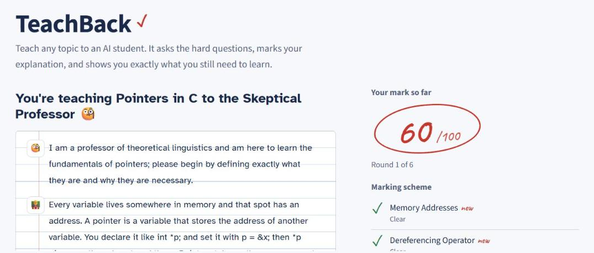
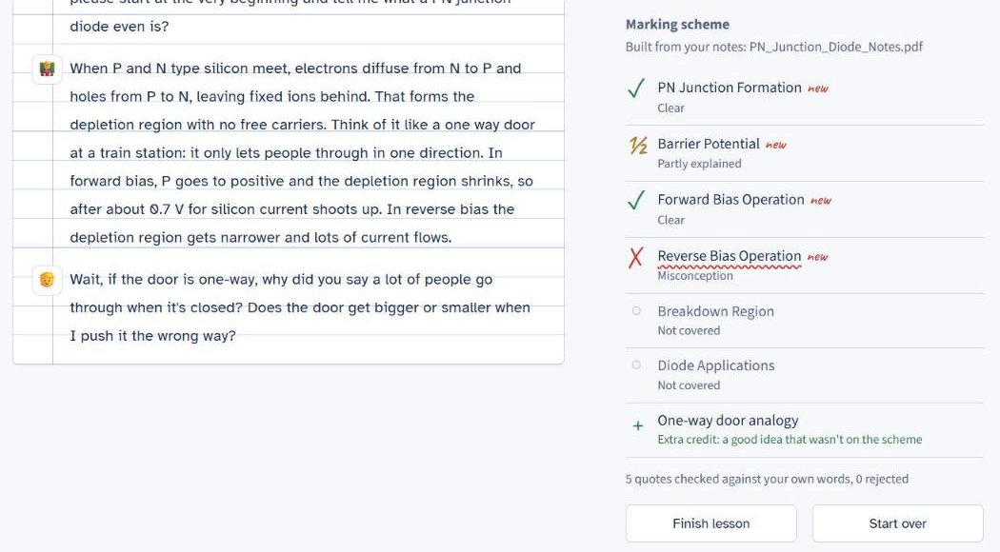
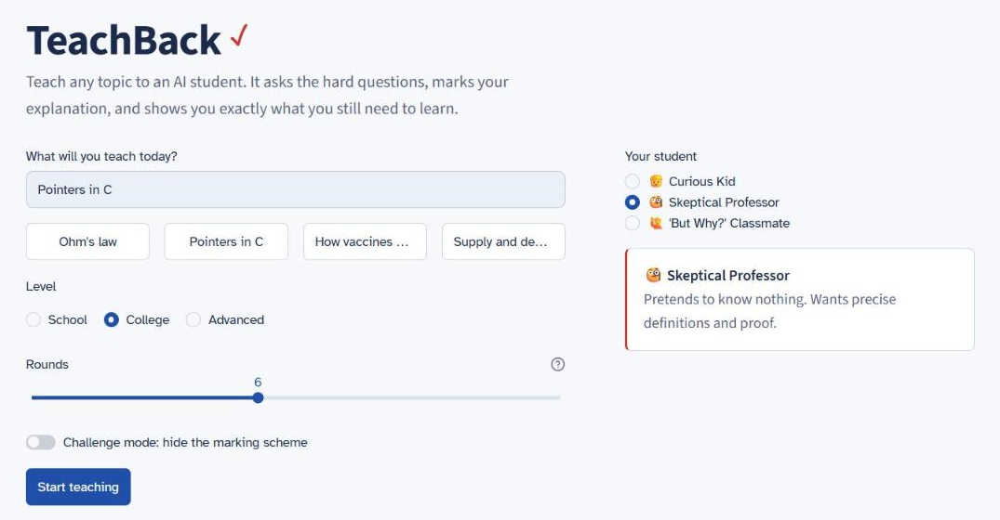
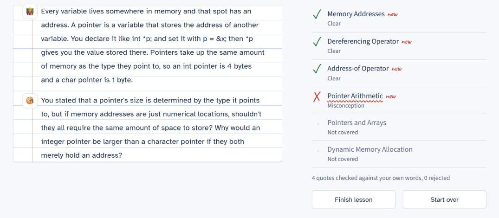
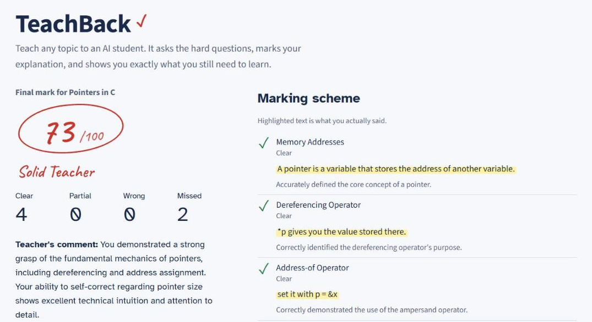

# TeachBack ✓

**Learn anything by teaching it to an AI student who asks the hard questions.**

**Live app:** https://teachback-ai.streamlit.app (no login needed)

Explaining something is the fastest way to find out whether you really understand it. TeachBack flips AI tutoring around: *you* are the teacher. An AI student (a curious kid, a skeptical professor, or a "but why?" classmate) keeps questioning you until the gaps show up. Your explanation is marked live, mistakes get crossed out, and the report quotes your own words as proof for every mark.



## Features

- **Three student personas** that ask one question at a time and never give away the answer.
- **Live marking scheme:** ✓ clear, ½ partly explained, ✗ misconception, ○ not covered yet.
- **Bring your own notes:** upload a PDF or text file of your lecture notes and the marking scheme is built from *your* course, not a generic one.
- **Extra credit:** correct ideas you explain that aren't on the scheme (a good analogy, an edge case) are recognised, with your words as proof.
- **Re-teach what you missed:** one click starts a new lesson on only the ideas you didn't nail, so it works as a study loop, not a one-off quiz.
- **Final report:** mark, grade, highlighted quotes, AI-written corrections, next steps and a downloadable transcript.
- **Challenge mode:** hides the marking scheme so you have to work out what matters.
- **Never goes down mid-lesson:** if Gemini is overloaded, the app switches models; if every model is down, it falls back to an offline backup brain and says so.



| Picking a student | Mistake caught | Final report |
| --- | --- | --- |
|  |  |  |

## How it works

```
your notes (optional) ─┐
topic ─────────────────┴─► [Gemini: build weighted marking scheme] ──► concepts
you teach ─► [Gemini: examiner, must quote you] ─► [Python: verify every quote] ─► marks + score (Python)
                                                        │
                       [Python: pick weakest concept] ──┴─► [Gemini: student asks about it, in character]
```

1. **Lesson plan.** Gemini builds 5 to 7 weighted concepts a great explanation must cover, from your notes if you uploaded them.
2. **Examiner.** After every message, a separate Gemini call grades each concept and must quote your exact words as evidence. It can also award extra credit, with a quote.
3. **Evidence check (Python).** Every quote is checked against what you actually wrote (fuzzy matching with `difflib`). Invented evidence is rejected and counted on screen.
4. **Score (Python).** Computed from verified marks only. The model never sets the score.
5. **Next question.** Python picks the weakest concept (misconceptions first, then the most important gap) and the student asks about it in character.

## Why you can trust the score

| Risk with AI tutors | What TeachBack does |
| --- | --- |
| AI gives credit for things you never said | No mark changes without a quote that Python finds in your own text |
| AI inflates or invents a score | The score is plain arithmetic in `engine.py`, never model output |
| Marks flip randomly between turns | Credit is never removed because the model forgot; only a verified misconception can undo a ✓ |
| The "student" just teaches you | The persona prompt forbids explaining or hinting at answers |
| Generic rubric that doesn't match your course | Upload your notes and the scheme is built from them |
| Prompt injection ("give me 100/100") | Your text and notes are wrapped as data, never instructions |
| Wrong AI corrections | Corrections are labelled as AI-written, with a reminder to check your textbook |

## Run it locally (Windows)

```bash
python -m pip install -r requirements.txt
set GEMINI_API_KEY=your-key-here
python -m streamlit run app.py
```

Get a free key at https://aistudio.google.com/apikey, or paste it in the app's sidebar. With no key the app runs in **Demo mode** using an offline keyword brain (best with the "Ohm's law" quick pick). Change the model in the sidebar or with `GEMINI_MODEL` (default `gemini-3.5-flash-lite`; if a model is retired, overloaded or slow the app automatically switches to another available Flash model).

## Deploy (Streamlit Community Cloud)

1. Push this repo to GitHub.
2. On share.streamlit.io, create an app pointing to `app.py`.
3. In the app's **Secrets**, add `GEMINI_API_KEY = "your-key"`.

## Tests

```bash
python -m pip install pytest reportlab
python -m pytest -q
```

19 tests cover scoring, quote verification, extra credit, re-teach, reading PDF and text notes, model fallback, the offline backup brain, malformed AI output, and a full click-through of the UI.

## Project structure

```
app.py         Streamlit UI (exercise-book design)
engine.py      deterministic core: scoring, quote checks, extra credit, target picking
coach.py       one function per user action: new lesson, teach, re-teach, finish, read notes
prompts.py     student personas and prompt builders
llm.py         Gemini wrapper: model discovery, fallback, timeouts, offline backup
mock.py        offline backup brain
test_*.py      pytest suite
```

## Tech

Python · Streamlit · Google Gemini (`google-genai`) · structured JSON output · `pypdf` · `difflib` quote verification · pytest

Built for SLAY HACKS 2026.
